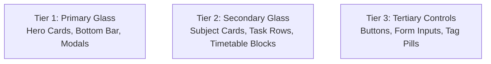

# BunkMatKar Design System Specification: Apple-Inspired Liquid Glass

## 1. Visual Philosophy & Aesthetic Principles

BunkMatKar employs an Apple-inspired **Liquid Glass** aesthetic engineered specifically for high-density academic workflows:

- **Calm, Premium & Focused:** The interface feels polished, tactile, and restrained. It evokes clarity and order, avoiding gaudy neon hues or visual noise.
- **Atmospheric Depth:** Soft, organic ambient lighting orbs (violet, indigo, deep cyan) emanate behind translucent glass surfaces, giving depth without distracting from text.
- **Physical Material Simulation:** Glass surfaces feature calibrated blur, subtle rim light specular borders, and soft diffused elevation shadows.
- **High Readability & Contrast:** Text contrast strictly satisfies WCAG AA (minimum 4.5:1 for body copy; 3:1 for large headers). Effects never compromise legible typography.

---

## 2. Color Palette & Semantic Tokens

### 2.1 Brand Tokens
| Token | Hex / Value | Semantic Role |
| :--- | :--- | :--- |
| `brand.violet` | `#7C3AED` | Primary brand accent, primary CTA background, focus rings |
| `brand.violetLight` | `#A78BFA` | Sub-headings on dark surfaces, subtle icons |
| `brand.violetDark` | `#5B21B6` | Pressed states, high-contrast borders |
| `brand.violetSoft` | `rgba(124, 58, 237, 0.10)` | Chip backgrounds, subtle badges, active pill backgrounds |
| `brand.indigo` | `#6366F1` | Secondary brand tone, calendar and timetable indicators |
| `brand.indigoSoft` | `rgba(99, 102, 241, 0.10)` | Secondary glass pill tint |

### 2.2 Semantic Status Tokens
Attendance and task urgency use four restrained semantic status colors:
| Status | Hex | Translucent Tint | Glass Border | Semantic Meaning |
| :--- | :--- | :--- | :--- | :--- |
| **Safe** | `#10B981` | `rgba(16, 185, 129, 0.10)` | `rgba(16, 185, 129, 0.24)` | Attendance safely above target; task completed |
| **Watch** | `#F59E0B` | `rgba(245, 158, 11, 0.10)` | `rgba(245, 158, 11, 0.24)` | Attendance within 1–2 classes of threshold; due soon |
| **Danger** | `#EF4444` | `rgba(239, 68, 68, 0.10)` | `rgba(239, 68, 68, 0.24)` | Attendance below threshold; immediate recovery needed; overdue |
| **Info** | `#3B82F6` | `rgba(59, 130, 246, 0.10)` | `rgba(59, 130, 246, 0.24)` | Informational notice, AI proposal preview, upcoming event |

---

## 3. Surface & Glass Hierarchy (3 Tiers)

To avoid "glass fatigue", the system defines three distinct material tiers:

### Tier 1: Primary Glass (`GlassCard level="primary"`)
- **Use Cases:** Hero current-class card, overall attendance card, bottom navigation bar, modal dialogs.
- **Light Mode:** `rgba(255, 255, 255, 0.64)`, Border: `rgba(255, 255, 255, 0.88)`, Backdrop Blur: `32px`, Top Specular Highlight: `rgba(255, 255, 255, 0.98)`.
- **Dark Mode:** `rgba(18, 19, 28, 0.58)`, Border: `rgba(255, 255, 255, 0.16)`, Backdrop Blur: `32px`, Top Specular Highlight: `rgba(255, 255, 255, 0.22)`.

### Tier 2: Secondary Glass (`GlassCard level="secondary"`)
- **Use Cases:** Subject cards, task items, timetable session rows, attention notifications.
- **Light Mode:** `rgba(255, 255, 255, 0.52)`, Border: `rgba(255, 255, 255, 0.75)`, Backdrop Blur: `20px`.
- **Dark Mode:** `rgba(24, 25, 36, 0.50)`, Border: `rgba(255, 255, 255, 0.10)`, Backdrop Blur: `20px`.

### Tier 3: Tertiary Solid/Control Glass
- **Use Cases:** Badges, form fields, filter chips, secondary buttons.
- **Properties:** Higher opacity (`0.76` in light; `0.70` in dark) with defined tactile borders to ensure touch-target affordance and input focus clarity.

---

## 4. Typography Scale

Clean system typography (SF Pro / Inter default):

| Token | Size | Weight | Line Height | Usage |
| :--- | :--- | :--- | :--- | :--- |
| `typography.hero` | `28px` | `700` (Bold) | `34px` | Hero headings, large attendance percentages |
| `typography.title` | `22px` | `700` (Bold) | `28px` | Screen titles, primary modal headers |
| `typography.subtitle`| `17px` | `600` (Semibold)| `22px` | Section titles, subject names |
| `typography.body` | `15px` | `400` (Regular) | `20px` | Standard body text, card descriptions |
| `typography.callout` | `14px` | `500` (Medium) | `18px` | Timetable slots, task metadata |
| `typography.caption` | `12px` | `500` (Medium) | `16px` | Timestamps, status tags, badges |
| `typography.micro` | `10px` | `600` (Semibold)| `12px` | Uppercase category labels, tiny indicators |

---

## 5. Component Library & Patterns

### 5.1 Buttons
- **Primary Action:** Solid `brand.violet` background, white text, 12px vertical padding, rounded 14px, subtle active scale `0.98`.
- **Secondary Action:** Glass button (`level="secondary"`), brand text, 1px specular border.
- **Destructive Action:** Subtle `status.dangerBg` background with `status.danger` text.

### 5.2 Forms & Inputs
- **Base State:** Inset glass surface (`colors.glassTertiary`), 14px border radius, 14px horizontal padding.
- **Focus State:** 1.5px solid `brand.violet` border with soft ambient glow.
- **Error State:** 1.5px solid `status.danger` border with inline message.

### 5.3 Empty & Loading States
- **Empty States:** Centered calm icon, bold title explaining the status, helpful description, and a single prominent call to action.
- **Loading / Skeletons:** Gentle shimmering pulse matching the current glass surface color rather than harsh grey blocks.

### 5.4 Motion & Accessibility
- **Transitions:** Smooth 200–250ms ease-out transitions for card presses, modal sheets, and tab switching.
- **Reduced-Motion Support:** If `useReducedMotion()` is enabled, all background orb drifting, floating companion bounces, and transform transitions collapse to instant or pure opacity fades.
