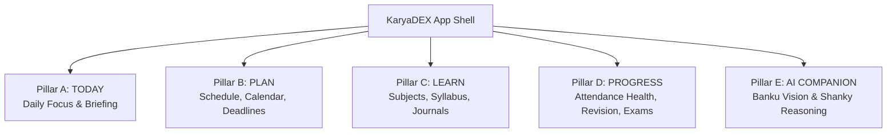

# KaryaDEX Information Architecture: The Five Pillars of Academic Life-Management

## 1. Overview of the Architecture

The redesigned information architecture transitions KaryaDEX from a fragmented collection of attendance counters and task lists into a cohesive, five-pillar academic operating system.

Every existing screen, feature, modal, and database entity maps cleanly into one of these five pillars, ensuring zero functional regression while delivering a radically improved user mental model.

---

## 2. Pillar Breakdown

### Pillar A: Today (The Daily Operating Base)
**Primary Question Answered:** *"What is happening right now, what matters today, and what is my next best action?"*

- **Purpose:** Serve as the first screen a student sees each morning. It eliminates cognitive friction within 3 seconds of opening the app.
- **Key Modules & Content:**
  - **Daily Academic Briefing:** Calm header with greeting, current date, semester indicator, and high-level daily status.
  - **Live Class Hero / Next Session:** Immediate visibility into the ongoing or upcoming class session (room, faculty, time remaining, attendance status).
  - **Daily Focus & What Matters Today:** Top 1–3 prioritized academic tasks (e.g. assignments due today/tomorrow, lab prep).
  - **Schedule Timeline:** Linear, chronological view of today's lecture and practical blocks.
  - **Micro-Revision Suggestion:** "20-minute review" prompt for recent topics taught.
  - **Attendance Health Indicator:** Non-intrusive confidence ring showing overall standing and priority classes to attend today.
- **Preserved Existing Routes / Modals:**
  - `app/(tabs)/index.tsx` (Today Screen)
  - `ClassSessionModal` (log attendance, notes, teacher instructions)
  - `DailyStudyPlanCard` (structured daily study blocks)
  - `AcademicHealthCard` (holistic health overview)
  - `AccountSettingsModal` & `NotificationSettingsModal`

---

### Pillar B: Plan (The Forward-Looking Organization Layer)
**Primary Question Answered:** *"What does my week look like, and how do I distribute my workload realistically?"*

- **Purpose:** Provide forward visibility into schedules, recurring classes, assignment deadlines, and college calendar milestones.
- **Key Modules & Content:**
  - **Weekly Timetable Engine:** Monday-to-Sunday interactive timetable view with day switcher, slot details, and room assignments.
  - **Task & Milestone Planner:** Filterable task system (By Due Date, Priority, Subject, Workload), subtasks, recurrence, and dependencies.
  - **Academic Calendar:** College holidays, mid-term weeks, exam periods, semester dates, and custom institutional milestones.
  - **Workload Forecasting:** Visual distribution of study hours and upcoming due dates across the current and upcoming weeks.
- **Preserved Existing Routes / Modals:**
  - `app/(tabs)/schedule.tsx` (Timetable & Daily Schedule)
  - `app/(tabs)/tasks.tsx` (Task Manager, Workload, Filters)
  - `AcademicCalendarView` (Institutional calendar & holidays)
  - `TaskRescheduleModal` & Add/Edit Task bottom sheets

---

### Pillar C: Learn (Subject Understanding & Curricular Mastery)
**Primary Question Answered:** *"What is being taught, what materials do I have, and how do I master the course content?"*

- **Purpose:** The centralized knowledge hub for every registered course, bridging timetable sessions with syllabus topics and lecture notes.
- **Key Modules & Content:**
  - **Registered Subject Hub:** Cards for each enrolled subject showing credits, instructor, room, and syllabus completion percentage.
  - **Syllabus & Topic Hierarchy:** Units, chapters, topics, subtopics, and difficulty markers.
  - **Class Journals & Lecture Logs:** Timestamped lecture notes, topics covered per class date, and attached slides/PDFs.
  - **Resource Locker:** Attached PDF handouts, past exam papers, reference links, and secure local file storage.
- **Preserved Existing Routes / Modals:**
  - `app/(tabs)/college.tsx` (Academic Hub & Subjects overview)
  - `app/subject/[id].tsx` (Deep Subject Detail Screen)
  - `SubjectSyllabusView` (Unit & topic breakdown)
  - `SubjectHistoryView` (Past class logs and journal entries)
  - `SubjectResourcesView` (Files and documents)
  - `TopicDetailModal` (Topic notes, mastery state, revision history)

---

### Pillar D: Progress (Academic Health, Analytics & Recovery)
**Primary Question Answered:** *"Where do I stand academically, and how do I maintain or recover my standing?"*

- **Purpose:** Diagnostic health center offering deterministic calculations, early risk detection, and clear recovery roadmaps without shame.
- **Key Modules & Content:**
  - **Attendance Health & Confidence:** Overall and subject-by-subject percentage, target comparison (e.g. 75%), safe cushion calculation, and required recovery classes.
  - **Recommended Attendance Plan:** Actionable weekly plan highlighting which classes must not be missed to stay safe.
  - **Syllabus Coverage & Topic Mastery:** Visual tracking of units taught vs. units revised.
  - **Revision Intelligence Hub:** Spaced repetition suggestions, topics slipping from memory, and scheduled review cycles.
  - **Examination Sprint Preparation:** Exam countdowns, targeted revision sprints, high-yield topic prioritization, and sprint trackers.
  - **Academic Health Index (AHI):** Multi-factor composite index combining attendance, task completion, and syllabus revision.
- **Preserved Existing Routes / Modals:**
  - `app/(tabs)/attendance.tsx` (Deterministic attendance calculator & recovery planner)
  - `AttendanceIntelligenceModal` (Recovery path simulator)
  - `RevisionHubModal` (Revision cycles & spaced repetition)
  - `ExamSprintModal` (Exam prep sprints & milestones)
  - `AttendanceForecastCard` & `AcademicHealthCard`

---

### Pillar E: Persistent AI Companion (Banku & Shanky)
**Primary Question Answered:** *"How can AI eliminate manual academic friction and give me personalized study clarity?"*

- **Purpose:** Seamless, floating assistant always within reach, offering specialized intelligence through two complementary personas:
  - **Banku (Vision & Multimodal Document Intelligence):**
    - Timetable image & PDF extraction into structured timetable slots.
    - Syllabus document & curriculum PDF parsing into units and topics.
    - College academic calendar & holiday notice extraction.
    - Lecture slides & handwritten notes visual analysis.
  - **Shanky (Conversational & Academic Reasoning Partner):**
    - Daily academic planning and task breakdown.
    - Attendance logic explanation and recovery planning in plain language.
    - Study timetable recommendations and exam revision strategies.
    - Subject conceptual Q&A and doubt resolution.
- **Implementation & Floating Shell:**
  - Persistent, non-obtrusive floating capsule across primary screens (`app/(tabs)/_layout.tsx`).
  - Animated, accessible selector between Banku and Shanky.
  - Direct integration into canonical validation gateways (`AIProposalCard`, draft preview confirmations).
  - Absolute preservation of multi-provider routing (Gemini for multimodal Banku, Mistral/Gateway for Shanky) with full offline fallback.

---

## 3. Route & Screen Mapping Matrix

To ensure that no existing screen or deep link breaks, the table below maps existing Expo Router paths to the redesigned pillars:

| Existing Route | Primary Pillar | Sub-Features & Components Included |
| :--- | :--- | :--- |
| `app/(tabs)/index.tsx` | **Pillar A: Today** | Today's timeline, Hero class, Daily tasks, Academic Health ring, Ambient header |
| `app/(tabs)/schedule.tsx` | **Pillar B: Plan** | Weekly timetable, day switcher, class slots, occurrence engine |
| `app/(tabs)/tasks.tsx` | **Pillar B: Plan** | Task CRUD, filters (Priority, Due Date), subtasks, recurrence, daily workload |
| `app/(tabs)/college.tsx` | **Pillar C: Learn** | Subject Hub, faculty info, syllabus links, semester switcher, academic calendar |
| `app/subject/[id].tsx` | **Pillar C: Learn** | Subject deep dive, Syllabus tab, History/Journal tab, Resources tab, Grades tab |
| `app/(tabs)/attendance.tsx` | **Pillar D: Progress** | Attendance health, target picker, recovery calculator, attendance records |
| Floating Overlay | **Pillar E: AI Companion** | Floating AI Companion, Banku/Shanky selector, AIAssistantModal, proposal flows |

All URL schemes, deep linking paths (`karyadex://...`), and internal `router.push('/(tabs)/...')` references remain 100% valid.
