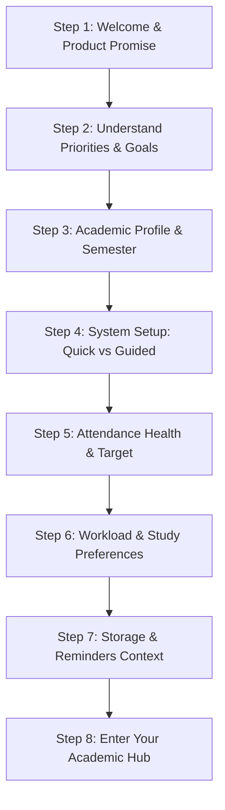

# KaryaDEX Onboarding UX Specification: Goal-Driven Academic Assistant Setup

## 1. Vision & Onboarding Principles

Onboarding is the critical threshold of KaryaDEX. Rather than feeling like an administrative compliance form or an anxiety-inducing attendance warning checklist, the onboarding journey must feel like **configuring an intelligent, calm, personal academic assistant**.

### Core Tenets:
1. **Goal-First, Not Fear-First:** The experience begins by understanding the student's aspirations (e.g. consistency, staying organized, exam readiness) rather than attendance panic.
2. **Flexible Pathways (Quick vs. Guided):** Respect the student's time. A busy student can complete Quick Setup in 45 seconds (adding core subjects and semester), while a student with PDFs/images can let Banku extract their timetable, syllabus, and calendar.
3. **No Fake Data, No Data Loss:** Existing real student data is never wiped on resume; demo data is strictly separated; and empty states are genuine rather than populated with hallucinated classes or fake attendance.
4. **Permissions with Clear Context:** Permissions (notifications, storage) are introduced with clear contextual rationale and remain strictly optional and non-blocking.

---

## 2. The 8-Step Onboarding Architecture

---

### Step 1: Welcome & Product Promise
- **User Experience:**
  - Premium Liquid Glass hero card with subtle violet atmospheric glow.
  - Reassuring header: *"Stay organized. Stay ahead. Make college life manageable."*
  - Clear statement of purpose: An academic life-management system designed to help you attend consistently, keep up with subjects, and prepare for exams without last-minute panic.
  - Primary button: *"Get Started"*
  - Secondary options: *"Resume Existing Setup"* (if draft detected) or *"Explore Interactive Demo"*.
- **Copy Guidelines:**
  - Avoid any mention of "safe bunks" or "classes to skip".
  - Emphasize calm control, academic clarity, and organized routines.

---

### Step 2: Understand the Student's Priorities
- **User Experience:**
  - Interactive multi-select goal cards allowing students to choose what matters most to them this semester:
    1. 🗓️ **Keep my college routine organized**
    2. 🎯 **Improve attendance consistency**
    3. 📝 **Stay on top of assignments & practicals**
    4. 📚 **Track subjects & syllabus completion**
    5. ⏳ **Build a sustainable study habit**
    6. 🚀 **Prepare for exams without last-minute panic**
    7. 🔔 **Reduce forgotten tasks & deadlines**
    8. 📊 **Understand my academic progress**
  - Instant tactile feedback (active glass border, checkmark icon, subtle haptics).
- **Behavioral Rule:**
  - Choices are stored in student preferences/profile.
  - Selections personalize home recommendations (e.g. prioritizing daily revision cards if "study habit" is chosen).
  - **Crucial:** Goal selections *never* lock or hide any core feature. Every student retains 100% full application access.

---

### Step 3: Academic Profile & Context
- **User Experience:**
  - Clean, concise input fields:
    - Student Name (and optional email)
    - Institution / College Name & Department
    - Program / Degree (e.g. B.Tech Computer Science, B.Sc, B.Com)
    - Current Year (1st, 2nd, 3rd, 4th) & Semester Number (1 to 8)
    - Semester Start Date & Estimated End Date
- **Persistence Rules:**
  - Reuses existing profile drafts if resuming.
  - Automatically initialises canonical semester record in SQLite upon confirmation.

---

### Step 4: Academic System Setup (Quick vs. Guided)
Students are presented with a clear choice between two frictionless pathways:

#### Pathway A: Quick Setup (Manual & Fast)
- For students who want to jump straight into the app.
- Input 3–6 subject names/codes (e.g. Data Structures, Operating Systems, Linear Algebra).
- Select a default color badge per subject.
- Timetable and syllabus details can be added or imported later from the Schedule or College tabs.

#### Pathway B: Guided Setup with Banku (Assisted Multimodal Imports)
Offers three optional document shortcuts powered by Banku:
1. **Import Timetable with Banku:**
   - Upload timetable photo, screenshot, or PDF.
   - Banku extracts class sessions, time slots, days, and room numbers.
   - User reviews an **interactive editable preview table**, adjusts any conflicting or uncertain slots, and confirms.
2. **Import Syllabus with Banku:**
   - Upload official university syllabus PDF or curriculum image.
   - Banku parses units, topics, and subtopics matched to registered subjects.
   - User previews, edits unit names, and approves.
3. **Import Academic Calendar with Banku:**
   - Upload institutional academic calendar or holiday circular.
   - Banku identifies semester milestones, mid-terms, final exams, and public holidays.
   - User reviews and confirms.
- **Fail-Safe Fallback:** Full manual alternative is always available for every single import. Imports are strictly optional.

---

### Step 5: Establish Attendance Health
- **User Experience:**
  - Slider or stepper to configure institutional attendance threshold (default: 75%; presets for 75%, 80%, 85%).
  - Baseline Attendance Entry:
    - If midway through a semester, option to enter existing attendance (e.g. 18 attended out of 22 conducted).
    - If beginning of semester, defaults cleanly to 0/0.
  - Plain-language explanation:
    - *"KaryaDEX tracks your attendance health deterministically. We calculate your safety cushion and recommend an attendance plan so you never face debarment surprises."*
- **Framing Rule:**
  - Positioned as configuring academic health and safety benchmarks, **never** as configuring "how many classes you can afford to skip".

---

### Step 6: Workload & Study Preferences
- **User Experience:**
  - Optional personal preference toggles:
    - Typical daily self-study availability (e.g. 1 hour, 2 hours, 3 hours).
    - Preferred daily study briefing time (Morning 8:00 AM vs. Evening 7:00 PM).
    - Revision preference (Spaced retrieval review vs. Weekend batch review).
- **Cognitive Load Control:**
  - Keep it lightweight (under 3 quick selectors). Detailed settings are deferred to the Settings menu.

---

### Step 7: Storage & Reminders (Contextual & Non-Blocking)
- **User Experience:**
  - **Reminders / Notifications:**
    - Explains: *"We send gentle reminders 15 minutes before your next class and daily morning briefings."*
    - Request permission button. If declined, the app accepts smoothly without nagging.
  - **File Storage:**
    - Explains: *"Where would you like to keep your downloaded notes, slides, and class attachments?"*
    - Standard App Sandboxed Storage (Recommended) or Custom Directory.
- **Crucial Rule:**
  - Permissions are strictly optional. Onboarding is never blocked if a permission is denied or postponed.

---

### Step 8: Enter Your Academic Hub
- **User Experience:**
  - Final review card summarizing configured subjects, timetable, attendance target, and goals.
  - Primary button: *"Enter KaryaDEX"*
  - The app smoothly transitions to the **Today** tab.
- **Dynamic Initialization:**
  - If a timetable was imported, today's actual classes immediately populate the Hero card and timeline.
  - If only subjects were added, Today displays clean, welcoming subject cards with helpful quick-action buttons: *"+ Add Class Session"*, *"+ Add First Task"*.
  - No synthetic/fake data is ever injected into real student workspaces.
  - Marks onboarding status as `'completed'` in SQLite database.
