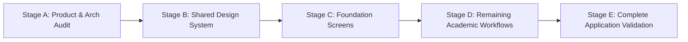

# KaryaDEX UI/UX Migration Plan: Staged Implementation Roadmap

## 1. Migration Strategy & Principles

To avoid disruption, regressions, or accidental data-binding breaks, the Phase 13 UI/UX reimagination proceeds across **five sequential stages (Stages A through E)**.

Each stage has defined prerequisites, implementation scope, and strict exit criteria. No stage begins until the previous stage passes automated tests and structural validation.

---

## 2. Stage Breakdown

---

### Stage A: Product and Architecture Audit (Complete)
- **Deliverables:**
  - `docs/product/PRODUCT_PHILOSOPHY.md`: Purpose reset from evasion/fear to academic life-management.
  - `docs/product/INFORMATION_ARCHITECTURE.md`: Organization around Five Pillars (Today, Plan, Learn, Progress, AI Companion).
  - `docs/product/ONBOARDING_UX_SPEC.md`: 8-step goal-driven assistant setup specification.
  - `docs/product/DESIGN_SYSTEM_SPEC.md`: Apple-inspired Liquid Glass 3-tier tokens, typography, and controls.
  - `docs/product/FEATURE_PRESERVATION_MAP.md`: Full catalog of preserved services, stores, repositories, and security gates.
  - `docs/product/UI_MIGRATION_PLAN.md`: This execution roadmap.
- **Exit Criteria:**
  - Full alignment on product direction.
  - 100% test suite passing (`npm test` 20/20 suites passed, 482/482 tests passed).
  - Zero TypeScript errors (`npx tsc --noEmit`).

---

### Stage B: Shared Design System Implementation
- **Scope:**
  - Review and enrich `constants/theme.ts` with updated semantic tokens (e.g. `status.safe`, `status.watch`, `status.danger`, `status.info`, glass tiers, ambient orbs).
  - Standardize reusable UI primitives in `components/ui/`:
    - `GlassCard.tsx`: Support `level="primary" | "secondary" | "tertiary"`, specular border, backdrop blur, elevation shadow.
    - `AttendanceRing.tsx`: Smooth percentage rendering, target marker tick, confidence glow.
    - `StatusBadge.tsx`: Restrained translucent badges for academic health and task priority.
    - `SectionHeader.tsx`: Unified header pattern with title, count badge, and optional action button.
    - `AmbientBackground.tsx`: Diffused orbs with reduced-motion awareness.
  - Ensure all tokens support light and dark modes seamlessly.
- **Exit Criteria:**
  - Shared components compile with zero TypeScript errors.
  - No alteration of database, sync, or authentication code.

---

### Stage C: Foundation Screens Migration
- **Target Screens:**
  1. **Onboarding Flow (`components/onboarding/*`):**
     - Refactor `StepWelcome.tsx` to communicate calm organization, consistent attendance, and academic mastery. Remove all references to "bunks to skip" or "danger thresholds".
     - Add goal-selection step (`StepGoals.tsx` / Step 2) supporting the 8 student priorities.
     - Enhance `StepAttendance.tsx` to frame target setting as sustainable attendance planning and early risk detection.
     - Ensure quick vs. guided setup pathways operate smoothly with Banku timetable/syllabus/calendar imports.
  2. **Today Screen (`app/(tabs)/index.tsx`):**
     - Align header with the calm academic daily briefing.
     - Frame hero class and schedule timeline around *"What is happening now and next"*.
     - Refactor attention items to present positive, actionable next steps instead of alarming warnings.
     - Integrate daily focus tasks and micro-revision prompts.
  3. **Navigation Shell & Floating AI Companion (`app/(tabs)/_layout.tsx`, `components/ai/FloatingAICompanion.tsx`):**
     - Maintain floating Liquid Glass bottom navigation bar.
     - Refine Floating AI Companion to ensure accessible touch targets, smooth persona switching (Banku vs. Shanky), and zero obstruction of bottom nav or FAB buttons.
- **Exit Criteria:**
  - Onboarding walkthrough completes end-to-end in both quick and guided modes.
  - Today screen renders live class occurrence, daily focus, and academic health correctly from SQLite.
  - All automated tests pass (`npm test`).

---

### Stage D: Remaining Academic Workflows Migration
- **Target Workflows:**
  1. **Plan Pillar (`app/(tabs)/schedule.tsx`, `app/(tabs)/tasks.tsx`, `AcademicCalendarView.tsx`):**
     - Timetable view with recurring weekly classes and occurrence intelligence.
     - Tasks screen reorganized around *"What matters today?"*, *"What is due next?"*, and workload distribution.
     - Calendar view with holidays and exam dates.
  2. **Learn Pillar (`app/(tabs)/college.tsx`, `app/subject/[id].tsx`, `SubjectSyllabusView.tsx`, `SubjectHistoryView.tsx`):**
     - Subject Hub presenting registered courses, syllabus progress, and faculty contact.
     - Class journal logs and lecture slide attachments.
     - Syllabus unit and topic breakdown with revision status markers.
  3. **Progress Pillar (`app/(tabs)/attendance.tsx`, `AttendanceIntelligenceModal.tsx`, `RevisionHubModal.tsx`, `ExamSprintModal.tsx`):**
     - Reframe attendance from "Can I Bunk?" to "Attendance Health & Confidence".
     - Highlight Recommended Attendance Plan and recovery classes required.
     - Retain deterministic simulation capabilities as an analytical tool, while making healthy attendance the default posture.
     - Spaced repetition revision hub and examination sprint preparation.
- **Exit Criteria:**
  - Every academic screen uses shared design system components.
  - Database queries, Zustand state updates, and cloud sync operations remain 100% intact.

---

### Stage E: Complete Application Validation & Regression Gate
- **Scope:**
  - Automated test execution: `npm test` (all suites must pass).
  - TypeScript validation: `npx tsc --noEmit`.
  - Expo production export verification: `npx expo export --platform web`.
  - Comprehensive user flow verification across onboarding, attendance simulation, task creation, timetable editing, syllabus tracking, revision logging, and AI companion interactions.
  - Generate Phase 13 readiness and sign-off report.
