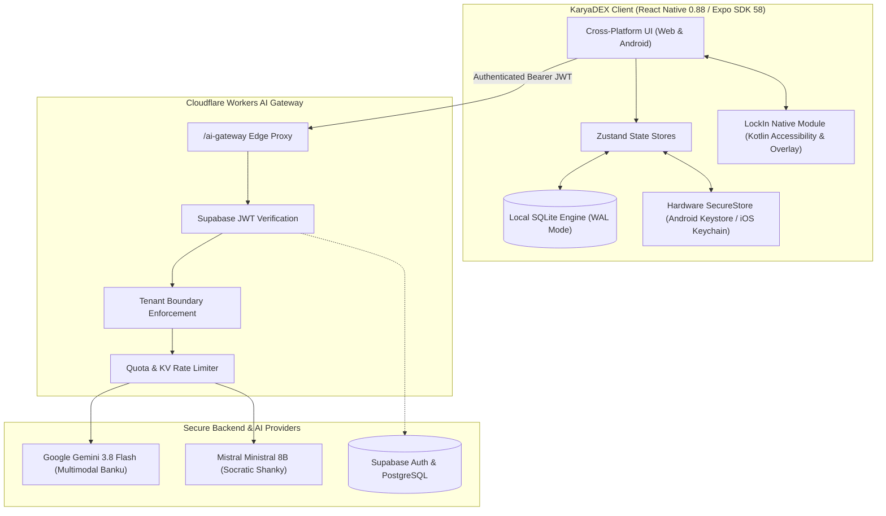

# KaryaDEX — The Intelligent Academic Operating System

[](https://opensource.org/licenses/MIT)
[](https://reactnative.dev/)
[](https://expo.dev/)
[](https://www.typescriptlang.org/)
[](https://www.sqlite.org/)
[](https://workers.cloudflare.com/)

**KaryaDEX** is an open-source, privacy-first, offline-capable college operating system designed to manage classes, attendance, syllabi, persistent study plans, cognitive focus, and AI-accelerated learning — across Android, iOS, and Web.

---

## Architecture Overview



---

## Key Modules

### 1. Academic Operating System
- **Attendance Intelligence:** Real-time safe-bunk calculation, attendance danger thresholds (75% default), recovery projection, and absence logging.
- **Recurring Timetable Engine:** Day-of-week slot expansion with alternating week patterns and calendar synchronization.
- **Class Journal:** Occurrence-bound lecture notes, teacher board captures, and topic status tracking.
- **Syllabus Tracker:** Hierarchical units and topics with revision progress (`not_started`, `taught`, `revised`, `needs_revision`).

### 2. Study OS
- **Persistent Versioned Study Plans:** SQLite-backed versioned study schedules (`study_plans` and `study_plan_allocations`). Supports auto-versioning ($v1 \rightarrow v2$), allocation completion/missed tracking, and deterministic schedule regeneration that preserves completed milestones while redistributing remaining topics across the days to the exam.
- **Dynamic Practice Center:** Generates active recall flashcards, 4-option multiple-choice questions, and conceptual True/False checks mapped to syllabus topics.
- **Banku Multimodal Document Extraction:** Server-side PDF and image ingestion using Gemini 3.8 Flash to extract subjects, units, and topics directly from syllabus documents into SQLite.
- **Shanky Conversational Socratic Tutor:** Conversational AI tutor using Mistral 8B for deductive step-by-step guidance, math equations, and local deterministic fallbacks when offline.

### 3. LockIn Deep Focus System
- **Native Android Accessibility Service:** Intercepts blacklisted distracting apps during active study sessions.
- **Reality Check Overlay:** Native full-screen friction dialog requiring conscious choice before launching distracting apps.
- **Doze Mode Alarm Receiver:** Exact alarm scheduling ensuring focus sessions activate reliably in battery-saver modes.

### 4. Cognitive Playground
- **Focus & Logic Games:** Queens solver, Sprint Duel arithmetic, and Tango constraint puzzles.
- **Strict Progression Barrier:** Isolated sandbox proving gaming XP, streaks, and ELO ratings never interfere with academic database records.

---

## Security & Privacy Blueprint

KaryaDEX is engineered so that **no sensitive secrets are ever exposed to the client application or public repositories**:

1. **Zero Provider Secrets in Bundles:** `GEMINI_API_KEY`, `MISTRAL_API_KEY`, and backend database secrets are never included in the Expo app code or client bundle.
2. **Edge Proxy Isolation:** Cloudflare Workers decrypts and routes AI requests server-side. The client application only receives sanitized data payloads.
3. **Mandatory JWT Authentication:** The gateway rejects unauthenticated requests with HTTP `401 Unauthorized` via Supabase JWKS signature validation.
4. **Tenant Boundary Enforcement:** The gateway strictly blocks cross-tenant execution (`request.userId === verifiedUserId`), rejecting mismatched requests with HTTP `403 Forbidden`.
5. **Hardware-Backed BYOK:** User-supplied API keys are encrypted via `expo-secure-store` inside Android Keystore / iOS Keychain. On web, keys exist only in ephemeral memory.
6. **File Upload Security:** Enforces magic byte verification (`%PDF-`, PNG, JPEG), 50MB ceiling, path traversal defense, and a strict blacklist prohibiting executable scripts (`.exe`, `.apk`, `.bat`, `.sh`, `.dll`).

---

## Getting Started

### Prerequisites
- **Node.js**: `>= 22.x` (LTS recommended)
- **npm**: Included with Node.js
- **Expo CLI**: Installed globally or executed via `npx expo`
- **JDK (for Android native builds)**: Java 17, 21, or 25 (OpenJDK)
- **Android SDK & platform-tools** (for Android development)

### 1. Clone the Repository
```bash
git clone https://github.com/Cartinem-DEV/KaryaDEX.git
cd KaryaDEX
```

### 2. Install Dependencies
```bash
# Install all app and gateway dependencies from workspace root
npm run setup
```
*(Or install individually inside `KaryaDEX/` and `workers/ai-gateway/` with `npm install`.)*

### 3. Configure Environment Variables
```bash
cd KaryaDEX
cp .env.example .env
```

Edit `.env` with your public identifiers:
```properties
EXPO_PUBLIC_SUPABASE_URL=https://your-project-id.supabase.co
EXPO_PUBLIC_SUPABASE_PUBLISHABLE_KEY=your-anon-publishable-key
EXPO_PUBLIC_GOOGLE_WEB_CLIENT_ID=your-google-client-id.apps.googleusercontent.com
EXPO_PUBLIC_CLOUDFLARE_WORKER_URL=https://your-worker.your-subdomain.workers.dev
```
*(Note: KaryaDEX operates fully in offline **Guest Mode** without cloud credentials).*

### 4. Run Development Server
```bash
# Start Web client (default port 8081)
npm run web

# Start Android development client
npm run android
```

---

## Testing & Quality Assurance

KaryaDEX enforces automated test suites covering persistence, AI guardrails, and runtime isolation:

```bash
# Run strict TypeScript compiler verification (0 errors required)
npm run typecheck

# Run all test suites
npm test

# Run Study OS and persistence tests
npm test -- StudyPlanPersistence.test.ts Study2_2_1_IntegrationClosure.test.ts StudyFunctionalIntelligence.test.ts
```

---

## Deploying the AI Gateway Backend

The AI Gateway proxy runs on Cloudflare Workers:

```bash
cd workers/ai-gateway
npm install

# Create KV namespace for rate limiting
npx wrangler kv:namespace create QUOTA_KV

# Configure production secrets securely
npx wrangler secret put GEMINI_API_KEY
npx wrangler secret put MISTRAL_API_KEY
npx wrangler secret put RESEND_API_KEY
npx wrangler secret put EMAIL_API_KEY

# Deploy worker to Cloudflare edge
npx wrangler deploy
```

---

## Contributing

We welcome contributions! Please see our [Contributing Guidelines](CONTRIBUTING.md) and [Security Policy](SECURITY.md) before submitting pull requests.

---

## License

This project is licensed under the [MIT License](LICENSE).
